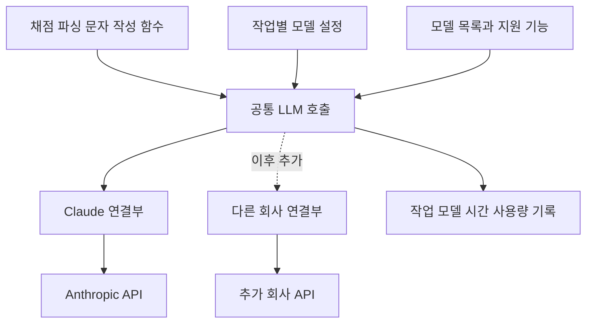

# EduNote LLM 모델 교체 설계서

작성일: 2026-10-06  
상태: 1~4단계 구현 및 검증 완료  
대상: EduNote 운영자와 구현 담당자

## 구현 현황과 모델 변경 방법

2026-10-07 기준 첫 구현 범위인 1~4단계를 구현했다. Claude 모델 선택, 프롬프트, 출력 한도, 채점과 문서 처리 정책은 기존 값을 유지한다. 실제 모델 호출을 통한 품질 비교와 5~6단계는 후속 작업이다.

- 작업 하나의 기본 모델을 변경하려면 [tasks.ts](C:/Users/user/Desktop/edunote/src/lib/llm/tasks.ts)의 해당 작업 `model`만 변경한다. 예를 들어 `vocab.gradeMeaning`의 변경은 OCR·문자·예문 생성의 기본 모델에 영향을 주지 않는다.
- 새 모델은 [models.ts](C:/Users/user/Desktop/edunote/src/lib/llm/models.ts)에 ID, 지원 기능과 확인한 요금을 등록한 뒤 작업 설정에서 선택한다. 작업 프롬프트를 바꾸는 경우에는 해당 작업의 프롬프트·출력 계약 버전도 검토한다.
- 비교 화면에서는 등록된 모델을 해당 요청에만 적용한다. 단어 채점은 저장된 맞춤 규칙, 진단평가 파싱은 교사의 유형 목록을 사용하며 결과를 저장하지 않는다. 적용 전 비교에는 실제 호출 비용이 발생한다.
- 운영 기본값은 설정 변경 후 배포로 적용한다. 문제가 생기면 해당 작업의 이전 모델 설정으로 되돌려 재배포한다.

현재 모델 목록의 출력 한도는 앱에서 허용하는 상한이다. 문맥 한도는 확인되지 않은 값을 임의로 채우지 않고 미확인으로 둔다. 입력의 정확한 토큰 수를 미리 계산하는 기능은 구현하지 않았으며, 공급사의 입력 한도 오류는 공통 오류로 구분한다.

검증 결과: `npm run check` 통과. 타입 검사와 린트 오류 0건, 단위테스트 65개 파일의 873개 사례가 통과했다. 기존 린트 경고 21건은 유지되며 새 경고는 없다. 새 라우팅·채점·PDF 작업·비교 경로 테스트 40개는 모의 응답으로 실행했다. 실제 LLM 호출, 개발·운영 DB 스키마 변경, 배포, 커밋과 푸시는 수행하지 않았다.

## 설계 결정

EduNote의 LLM 호출을 **작업별 모델 설정, 공통 호출, 회사별 연결부**로 분리한다. 첫 구현에서는 현재 Claude 모델과 채점 동작을 유지한다. 다른 회사의 모델은 이후 검증할 작업에만 연결한다.

이 구조의 목표는 새 모델이 나왔을 때 설정 한 곳에서 특정 작업만 교체하고, 문제가 생기면 이전 설정으로 되돌릴 수 있게 하는 것이다. 예를 들어 문자 작성에는 새 모델을 사용하면서 단어 채점과 이름 판독에는 검증된 기존 모델을 유지할 수 있다.

| 구분 | 범위 |
| --- | --- |
| 첫 구현 | 작업별 모델 설정, Claude 연결부 분리, 호출 결과 정규화, 운영과 같은 경로의 모델 비교 |
| 이후 확장 | 다른 회사의 텍스트 모델 연결, 작업별 평가 후 선택적 전환 |
| 별도 후속 작업 | 관리자 화면에서 즉시 모델 변경, PDF 처리 방식의 회사별 최적화, 결과 캐시 버전 관리 |
| 이번 설계에서 보류 | JEV 도입, 최신 모델 자동 전환, 자동으로 다른 회사에 재요청하는 정책 |

첫 구현에는 DB 스키마 변경이 필요하지 않다. 모델 설정은 저장소에서 관리하고 배포로 적용한다. 관리자 화면에서 배포 없이 변경하는 기능은 별도 단계로 둔다.

## 현재 구조와 개선 지점

[현재 모델 설정](C:/Users/user/Desktop/edunote/src/lib/llm/client.ts:25)은 `parse`, `explanation`, `light` 세 역할로 구분되어 있다. 중앙 설정을 유지하되 작업의 범위를 더 명확하게 나눌 필요가 있다.

| 현재 구조 | 모델 교체 시 영향 | 개선 방향 |
| --- | --- | --- |
| `light`에 채점, 문자, 예문, 이름 판독을 함께 연결 | 한 모델 변경으로 성격이 다른 여러 기능이 바뀜 | 작업별 선택을 독립적으로 관리 |
| `parse`에 파일 파싱과 서술형 채점을 함께 연결 | 텍스트 채점과 파일 인식의 품질을 함께 검증해야 함 | 파일 작업과 채점 작업을 분리 |
| 호출 입력에 Anthropic SDK 타입 사용 | 다른 회사 연결 시 업무 코드까지 수정 필요 | 공통 입력을 회사별 연결부에서 변환 |
| 범위 파싱 코드가 Claude 캐시 옵션을 직접 작성 | 다른 회사에서 비용과 동작이 달라짐 | 캐시 의도를 공통 형식으로 표현 |
| 모델명 정규식으로 옵션 지원 여부 판단 | 새 모델 이름이 나올 때 호출 코드 수정 필요 | 모델별 지원 기능을 설정으로 관리 |
| 비교 도구가 별도 호출 코드와 모델 목록 사용 | 비교 결과와 운영 결과가 달라질 수 있음 | 실제 업무 함수에 비교 모델만 임시 지정 |

회사별 의존성은 API 호출 이외에도 존재한다. [어휘 보강](C:/Users/user/Desktop/edunote/src/lib/vocab-enrichment.ts:86) 등은 `ANTHROPIC_API_KEY` 존재 여부로 기능을 실행한다. 이 판단도 공통 설정 확인으로 옮겨야 한다.

## 목표 구조와 책임



| 계층 | 담당하는 일 |
| --- | --- |
| 업무 함수 | 프롬프트 구성, 채점 정책, 배치와 범위 분할, 결과 해석, 기존 오류 대응 |
| 작업 설정 | 해당 작업의 기본 모델과 필요한 입력 기능 지정 |
| 모델 목록 | 회사, 실제 모델 ID, 지원 기능, 회사별 호출 옵션, 요금 정보 관리 |
| 공통 호출 | 설정 해석, 입력 호환성 확인, 연결부 선택, 공통 실행 기록 |
| 회사별 연결부 | SDK 초기화, 파일 변환, 캐시 옵션, 내부 스트리밍, 응답과 오류 변환 |
| JSON 처리 | 기존 펜스 제거와 JSON 복구 함수 제공 |

채점 규칙은 [기존 프롬프트](C:/Users/user/Desktop/edunote/src/lib/prompts.ts:646)와 저장된 맞춤 규칙에서 가져온다. 연결부가 규칙을 요약하거나 바꾸지 않는다. 모델 교체와 채점 정책 변경은 별도 변경으로 관리한다.

API 키는 서버 환경변수로 관리한다. 모델 목록과 비교 화면에는 모델 정보만 제공한다. SDK 클라이언트는 실제 호출할 때 생성해, JSON 처리나 설정 검사만 수행할 때 키가 필요하지 않도록 한다.

## 작업별 모델 설정

작업 ID는 공급사나 모델명 대신 업무 이름으로 정한다. 아래는 첫 구현의 작업 구분안이며, 기본 모델은 현재 코드의 선택을 유지한다.

| 작업 ID | 작업 | 현재 기본 모델 |
| --- | --- | --- |
| `vocab.gradeMeaning` | 단어 뜻 정오 판정 | `claude-haiku-4-5-20251001` |
| `week.gradeSubjective` | 서술형 정오와 피드백 | `claude-sonnet-5` |
| `vocab.answerOcr` | 단어 시험 사진 답안 판독 | `claude-sonnet-5` |
| `vocab.sheetName` | 단어 시험지 이름 판독 | `claude-haiku-4-5-20251001` |
| `vocab.parsePdf` | 단어장 파일 추출 | `claude-sonnet-5` |
| `vocab.generateExamples` | 예문과 오답 후보 생성 | `claude-haiku-4-5-20251001` |
| `vocab.hint` | 재시험 힌트 생성 | `claude-haiku-4-5-20251001` |
| `vocab.enrich` | 어휘 뜻과 변형 자료 보강 | `claude-haiku-4-5-20251001` |
| `week.parseAnswers` | 진단평가 해설이 포함된 시험 자료 파싱 | `claude-sonnet-5` |
| `examBank.parseQuestions` | 기출 시험지 파싱 | `claude-sonnet-5` |
| `examBank.extractExplanations` | 기출 해설 추출과 보완 | `claude-sonnet-5` |
| `mockExam.parseMetadata` | 모의고사 유형과 정답 정보 추출 | `claude-sonnet-5` |
| `mockExam.answerOcr` | 모의고사 답안과 OMR 판독 | `claude-sonnet-5` |
| `sms.write` | 학부모 문자 생성과 문구 다듬기 | `claude-haiku-4-5-20251001` |
| `textCompare.analyze` | 시험 변형 분석과 종합 | `claude-opus-5` |
| `pdf.extractText` | PDF 텍스트 복원 | `claude-sonnet-5` |

같은 모델을 사용하는 작업도 설정 항목은 독립적으로 둔다. 작업 설정은 모델 목록의 항목을 참조하며, 실제 모델 ID를 각 업무 파일에 반복해서 적지 않는다.

작업의 기본 모델과 호출 단계의 옵션은 구분한다. 같은 PDF 작업이라도 캐시 예열, 번호 발견, 문항 추출의 출력 한도가 다르다. 첫 구현에서는 현재 호출별 출력 한도와 옵션을 그대로 전달하고, 이후 필요할 때 단계별 실행 설정을 중앙화한다.

## 모델 목록과 호환성 확인

모델 목록에는 다음 정보를 둔다.

| 정보 | 용도 |
| --- | --- |
| 내부 모델 참조와 공급사 | 작업 설정에서 선택하고 연결부를 결정 |
| 실제 모델 ID | 공급사에 전송할 검증된 모델 지정 |
| 이미지와 PDF 지원 | 파일 작업에 사용 가능한지 확인 |
| 최대 출력과 문맥 한도 | 호출 옵션과 입력 크기가 호환되는지 확인 |
| 캐시와 예열 지원 | 범위 파싱 전략을 실행할 수 있는지 확인 |
| temperature와 추론 옵션 | 지원하지 않는 옵션이 전송되지 않도록 처리 |
| 구조화 출력 지원 | 이후 출력 형식 강화 시 활용 |
| 요금과 확인일 | 캐시와 출력 사용량을 포함한 예상 비용 계산 |

지원 기능이 확인되지 않은 모델은 해당 작업의 운영 후보에 등록하지 않는다. PDF를 지원하지 않는 모델에 첨부 파일을 누락해 보내거나, 입력을 자동으로 다른 방식으로 바꾸지 않는다.

현재 [모델명에 따른 옵션 분기](C:/Users/user/Desktop/edunote/src/lib/llm/client.ts:83)는 모델별 정보로 이동한다. 기존에 생략하던 옵션은 동일하게 생략해 첫 전환의 요청을 보존한다. 신규 모델의 지원 여부가 불분명할 때는 등록 또는 호환성 검사에서 중단한다.

모델 ID는 검증한 값을 명시한다. 공급사가 고정 버전을 제공하면 그 버전을 선택한다. 별칭만 제공하거나 같은 ID의 동작이 갱신되는 경우에는 반환된 모델 정보와 평가 날짜를 기록한다. EduNote의 설정 고정만으로 공급사 내부 변경까지 고정할 수는 없다.

## 공통 호출과 결과 계약

공통 호출은 업무에서 필요한 텍스트와 파일만 표현한다. SDK 타입과 `cache_control` 같은 회사별 필드는 연결부 내부에서 작성한다.

| 공통 입력 | 설명 |
| --- | --- |
| `task` | 실행할 작업 ID |
| `execution` | 서버 실행 시작 시 확정한 작업별 모델 연결과 설정 버전 |
| `content` | 순서가 유지되는 텍스트, 이미지, PDF 블록 |
| `maxOutputTokens` | 해당 호출 단계의 출력 한도 |
| `cacheBoundary` | 재사용할 공통 접두부의 끝 위치 |
| `delivery` | 일반 응답 또는 내부 스트리밍 수신 |
| `signal` | 취소와 전체 실행 시간 관리 |

현재 내부 스트리밍은 긴 응답의 연결을 유지하고 최종 텍스트를 수집하는 용도다. 첫 구현에서 사용자 화면에 토큰을 실시간 표시하는 기능은 추가하지 않는다.

| 공통 결과 | 설명 |
| --- | --- |
| `text` | 연결부가 모은 생성 텍스트 |
| `finishReason` | 완료, 출력 한도 도달, 거절, 기타 종료 |
| `usage` | 입력, 출력, 캐시 읽기와 쓰기 사용량 |
| 실행 정보 | 작업, 공급사, 요청 모델, 반환 모델, 설정 버전, 소요 시간 |
| 공급사 부가 정보 | 비용이나 문제 조사에 필요한 공급사별 사용량 세부 항목 |

사용량이 제공되지 않은 항목은 미확인으로 표현한다. 공급사마다 사용량의 포함 관계와 캐시 요금이 다르므로, 비용 계산은 공급사별 규칙으로 수행하고 중복 합산하지 않는다. 요금이 없으면 무료가 아니라 비용 미확인으로 표시한다.

네트워크, 인증, 호출량 제한, 입력 한도, 미지원 기능, 거절은 구분한다. 종료 사유는 연결부에서 정규화한다. 거절 응답은 공통 호출에서 사용량과 반환 모델 정보를 포함한 공통 거절 오류로 변환해 던지고, 정상 결과나 JSON 파서로 전달하지 않는다. 기존 거절 판별 함수가 이 오류를 인식하게 해 업무의 재시도와 검토 처리가 같은 조건에서 실행되게 한다. 첫 구현에서 재시도 횟수나 다른 모델로의 자동 전환을 추가하지 않는다.

기존 JSON 복구 함수는 독립 모듈로 옮기되 동작을 유지한다. 엄격한 스키마 강제나 누락 답안 재요청은 모델 교체 구조와 분리해 검토한다.

## PDF 캐시와 여러 호출의 일관성

현재 [범위 파싱](C:/Users/user/Desktop/edunote/src/lib/llm/ranged.ts:72)은 파일과 공통 프롬프트를 캐시하고, 뒤에 문항별 지시를 붙인다. [예열](C:/Users/user/Desktop/edunote/src/lib/llm/ranged.ts:167)은 출력 한도를 0으로 지정하는 Claude 호출이다.

공통 호출에는 일반 생성과 예열을 호출 유형으로 구분한다. 예열은 별도 작업 ID가 아니며, 번호 발견과 문항 추출에 사용하는 작업별 모델 연결을 공유한다. 일반 생성 요청은 양의 출력 한도를 사용하고, 예열 연결부만 공급사의 특수 호출을 작성한다. 예열을 지원하지 않는 연결부는 명확하게 미지원 오류를 반환한다.

첫 구현에서 지켜야 할 조건은 다음과 같다.

1. 파일과 공통 프롬프트의 블록 순서, 내용, 캐시 경계를 유지한다.
2. 예열, 번호 발견, 문항별 추출은 작업 시작 시 선택한 같은 모델을 사용한다.
3. 문항당 호출 수, 병렬 처리, 필터 거절과 JSON 오류의 문항 격리 처리를 유지한다.
4. SDK와 상위 코드에 재시도가 중복 추가되지 않도록 현재 정책을 옮긴다.

첫 구현에서는 한 번의 서버 요청에서 사용될 작업별 설정을 실행 시작 시 확정한다. 하위 호출, 병렬 배치와 재시도는 이 실행 정보를 공유한다. 단어 사진 채점은 OCR의 Sonnet과 뜻 채점의 Haiku를 각각 고정하며, 전체 실행에 모델 하나를 강제하지 않는다.

여러 HTTP 요청이나 중단 후 재개까지 같은 설정을 보장하는 기능은 후속 범위다. 그 단계에서는 실행 정보를 작업 데이터에 저장하고, 요청마다 서버가 허용된 설정인지 확인한다. 모델과 설정 버전을 저장할 컬럼이 필요하면 migration SQL을 함께 작성한다. 첫 구현의 메모리 내 설정 고정은 재배포를 사이에 둔 재개까지 보장하지 않는다.

다른 회사의 PDF 모델을 추가할 때는 파일 업로드 방식, 문맥 한도, 캐시 비용, 호출 제한을 함께 평가한다. 캐시 없는 모델의 호출 분할 방식은 별도 전환 계획에서 검증하고 결정한다.

## 모델 비교와 교체 절차

비교 도구는 운영의 실제 업무 함수를 실행한다. 선택한 작업의 모델 연결만 해당 실행에서 임시 지정하고, 프롬프트, 맞춤 규칙, 배치, 출력 한도, 후처리는 운영 경로와 동일하게 사용한다. 예를 들어 `vocab.gradeMeaning`을 비교할 때 OCR 모델은 기존 설정을 유지한다.

비교 실행은 DB 저장 라우트와 분리한다. 입력을 읽고 결과를 반환하는 함수까지 실행하며, 답안 저장이나 문자 발송 단계에는 진입하지 않는다. 임시 모델 지정은 등록된 모델 참조로만 허용하고, 운영의 기본 설정과 동시에 실행되는 다른 요청에 영향을 주지 않는다. 일반 업무 API의 임의 입력을 모델 선택으로 연결하지 않는다.

[현재 비교 API](C:/Users/user/Desktop/edunote/src/app/api/dev/compare/route.ts:14)와 [비교 화면](C:/Users/user/Desktop/edunote/src/components/dev/model-compare.tsx:13)의 모델과 요금 목록은 중앙 목록에서 가져온다. 비교 API, OCR 도구, 비교 스크립트의 공용 계층 우회도 함께 정리한다. CLOVA OCR 같은 별도 OCR 서비스는 해당 기능의 기존 연결로 유지한다.

| 평가 항목 | 확인 내용 |
| --- | --- |
| 채점 품질 | 교사가 확정한 정오와의 일치, 다의어, 품사, 오타, 맞춤 규칙 |
| 파일 품질 | 문항 누락과 중복, 번호와 학생 매칭, 지문과 답안 복원 |
| 생성 품질 | 해설과 예문의 내용, 문자 형식, 요구한 출력 구조 |
| 실행 성능 | 전체 완료 시간, 호출 수, 재시도, 오류율 |
| 비용 | 모든 호출의 입력과 출력, 캐시 읽기와 쓰기, 재시도 비용 |

기존 [단어 채점 비교 사례](C:/Users/user/Desktop/edunote/scripts/compare-vocab-grading-models.ts:28)는 출발점으로 사용한다. 다만 같은 답안의 정오가 서로 다르게 적힌 기본 규칙과 기대값은 평가 전에 확정해야 한다. 모델 교체 구조를 만들면서 채점 정책까지 동시에 바꾸지 않는다.

새 모델 적용 순서는 다음과 같다.

1. 모델 목록에 지원 기능과 요금을 등록한다.
2. 대상 작업에서 기존 모델과 같은 입력으로 비교한다.
3. 작업별 허용 품질과 완료 시간, 비용 기준을 충족한 모델을 선택한다.
4. 해당 작업의 기본 설정만 변경하고 배포한다.
5. 문제가 생기면 해당 작업을 이전 설정으로 되돌리고 재배포한다.

되돌리기는 이후 실행에 적용된다. 이미 저장된 채점이나 해설은 자동으로 삭제하거나 재생성하지 않는다. 기존 결과의 재채점과 재생성은 별도 작업으로 다룬다.

## 실행 기록과 설정 운영

각 호출에 작업 ID, 공급사, 요청 모델, 반환 모델, 설정 버전, 소요 시간, 종료 사유, 사용량, 재시도 정보를 남긴다. PDF처럼 여러 호출로 이루어진 작업에는 같은 실행 ID를 사용해 전체 시간과 비용을 묶어 볼 수 있게 한다.

프롬프트 식별 정보에는 작업별 규칙과 출력 계약의 버전, 맞춤 규칙의 내용 해시를 포함한다. 실제 입력이 포함된 프롬프트의 해시도 기록해 같은 요청인지 구분한다. 한 번의 서버 실행에서 맞춤 규칙은 시작 시점의 값을 공유한다. 일반 실행 기록에는 전체 학생 답안이나 파일 본문을 추가하지 않는다.

첫 구현은 공통 로그 형식을 제공하고 현재 사용량 기록을 통합한다. 영구 집계용 DB 테이블이나 별도 대시보드는 후속 범위다. 비교 도구에는 한 실행의 결과와 총사용량을 표시한다.

키가 없는 선택 모델은 해당 작업의 설정 미완료로 판단한다. 선택 기능이 현재 키 미설정 시 건너뛰도록 되어 있다면 그 정책을 유지하되, 특정 회사의 환경변수를 직접 확인하는 대신 작업 설정을 확인한다.

## 구현 파일 구성안

아래 파일명은 구현 시의 제안이다.

```text
src/lib/llm/
  tasks.ts                 작업별 기본 모델과 요구 기능
  models.ts                실제 모델 목록과 지원 기능
  types.ts                 공통 입력 결과 실행 정보
  client.ts                설정 해석과 공통 호출
  errors.ts                공통 오류와 기존 오류 판별 호환
  json.ts                  기존 JSON 추출과 복구 함수
  providers/
    anthropic.ts           현재 SDK를 사용하는 Claude 연결부
  vocab.ts week.ts ...      기존 업무 함수
```

기존 `src/lib/anthropic.ts`의 업무 함수 재내보내기는 호환용으로 유지할 수 있다. 실제 SDK 인스턴스의 직접 사용은 연결부 안으로 한정한다. 신규 코드는 공급사 이름이 없는 공통 진입점이나 해당 업무 모듈을 사용한다.

공통 호출부는 필요한 기능만 제공한다. 채팅 UI, 도구 실행 에이전트, 새 관리자 화면, 여러 회사의 전체 SDK 구현은 첫 단계에 포함하지 않는다.

## 단계별 전환과 완료 기준

| 단계 | 작업 | 완료 기준 |
| --- | --- | --- |
| 1 | 작업 ID와 모델 목록 도입 | 현재 모델과 호출 옵션이 동일하고 작업 하나만 독립 변경 가능 |
| 2 | 공통 타입과 Claude 연결부 분리 | 업무 코드의 Anthropic 타입과 캐시 필드를 연결부로 이동 |
| 3 | 운영 호출과 설정 확인 통합 | 실제 LLM 요청과 키 확인이 공용 계층을 통하며 기존 오류 대응 유지 |
| 4 | 비교 도구 통합 | 운영과 같은 함수에 임시 모델을 지정하고 저장 없이 비교 가능 |
| 5 | 다른 회사의 텍스트 작업 연결 | 연결부 추가와 작업 설정 변경으로 해당 작업 실행 가능 |
| 6 | PDF 또는 관리자 설정 확장 | 대상 기능의 비용과 동작을 별도로 검증한 후 구현 |

1~4가 첫 구현의 범위다. 기본 모델, 프롬프트, 출력 한도, 배치와 캐시 전략을 보존하는 구조 변경으로 진행한다. 실제 신모델 전환은 구조 변경 이후 평가 결과에 따라 별도로 적용한다.

첫 구현의 검증은 다음을 포함한다.

- 대표 호출의 Anthropic 요청을 모의 응답으로 비교해 모델, 프롬프트 내용, 파일 블록, 캐시 경계와 옵션을 확인한다.
- 임시 모델 지정이 기본 설정과 병렬 요청에 영향을 주지 않는지 확인한다.
- 미지원 이미지나 PDF, 출력 한도 오류가 실제 요청 전에 검출되는지 확인한다.
- 거절, 출력 잘림, 호출량 제한, 인증과 네트워크 오류가 서로 다른 상태로 유지되는지 확인한다.
- 단어 채점의 출력 잘림 실패와 재시험의 입력 순서 대응을 유지한다. 재시험은 현재 모든 `number`가 0이므로 번호 고유성을 새로 강제하지 않는다.
- 서술형 채점의 30개 이하 단일 배치, 초과 시 문항별 배치, 실패와 누락의 검토 표시를 유지한다.
- PDF 범위 파싱의 예열과 문항 격리, 내부 스트리밍의 최종 텍스트 수집을 확인한다.
- 비교 함수가 답안 저장과 문자 발송을 호출하지 않는지 확인한다.
- 코드 변경 완료 전 `npm run check`를 직접 실행해 타입 검사, 린트, 유닛테스트를 통과한다.

유닛테스트는 네트워크를 모의 처리한다. 실제 모델 비교는 비용이 발생하므로 사용자가 요청한 평가에 한해 실행한다. `npm run test:parse`도 같은 원칙을 따른다.

엄격한 결과 스키마와 문항별 고유 ID 도입은 후속 품질 개선으로 구분한다. 첫 단계에서 기존 답안 대응 규칙을 바꾸면 모델 설정 개선과 채점 동작 변경이 섞이기 때문이다.

## 도구 선택과 이후 확장

첫 구현은 현재 Anthropic SDK를 연결부 내부에서 계속 사용한다. 공통 계층을 만들기 위해 새 외부 서비스를 도입할 필요는 없다.

여러 공급사 연결을 실제로 추가할 때는 [AI SDK의 공통 호출 기능](https://ai-sdk.dev/docs/introduction)을 검토할 수 있다. [Anthropic 연결부](https://ai-sdk.dev/providers/ai-sdk-providers/anthropic)는 Anthropic API를 직접 호출할 수 있으므로 Vercel Gateway 사용이 필수는 아니다. 채택하더라도 EduNote의 업무 함수와 작업 설정은 자체 공통 계층을 유지하고, SDK 사용은 연결부 내부로 한정한다.

회사 간 호출 형식의 독립성과 같은 프롬프트의 품질 동등성은 구분한다. 공통 계층은 연동 수정 범위를 줄이며, 회사별 모델의 채점과 파일 처리 품질은 작업별 평가로 확인한다.

관리자 화면을 추가하는 단계에서는 변경 이력과 이전 설정 복귀를 제공하고, 실행 중인 작업의 설정을 유지한다. 설정과 실행 정보를 DB에 저장하는 스키마 변경이 필요하면 저장소 규칙에 따라 migration SQL도 함께 작성한다.

저장된 예문과 어휘 뜻 등 결과 캐시는 모델 설정 변경만으로 갱신되지 않는다. 모델이나 규칙이 바뀌었을 때 기존 결과를 계속 사용할지, 버전을 구분할지, 명시적으로 재생성할지는 대상 기능별 후속 정책으로 정한다.
